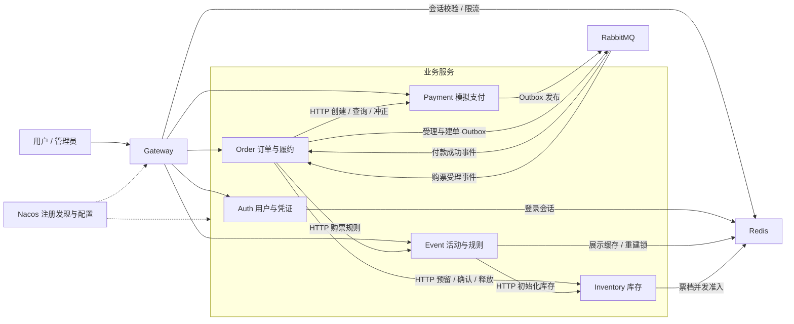

# 分布式票务交易平台

基于 **Spring Boot / Spring Cloud** 的活动票务交易平台，覆盖管理员创建活动、准备库存和发布，以及用户选座、同步或异步购票、模拟付款和电子票生成。提供轻量购票展示页与完整 API。

项目拆分为 **6 个独立微服务、4 个公共模块、5 个业务数据库**。围绕跨服务交易，实现了可靠消息、最终一致性、缓存与限流、热点库存保护、故障隔离、分布式追踪和容器部署。

## 核心业务功能

| 业务 | 已实现功能 |
| --- | --- |
| 用户与认证 | 注册、登录、刷新凭证、退出登录；普通用户与管理员权限；JWT 签名及 Redis 会话校验 |
| 活动管理 | 创建包含场次和票档的完整草稿，后台初始化库存，查询准备进度、按原参数重新准备、发布活动 |
| 活动查询 | 已发布活动分页、详情、场次和票档查询；Redis 展示缓存及热点重建保护 |
| 订单与限购 | 同步建单、异步受理与结果查询；价格/规则/座位快照、购买幂等键、单场累计限购及活动不同场次数限购 |
| 库存管理 | Redis Lua 前置预扣、持久化准入账本、取消墓碑、代次重建；MySQL 条件更新保留最终数量护栏 |
| 规则管理 | Drools 执行购票规则；规则参数草稿、版本发布、历史查询和新版本回滚，已受理请求沿用原快照 |
| 选座与展示 | 草稿配置不可变区域网格、座位预扣/确认/释放、座位电子票；游标列表、视窗加载、版本增量和虚拟渲染 |
| 模拟支付 | 从原订单创建支付单、查询本人支付单、模拟付款成功；付款事实核对及迟到付款全额模拟冲正 |
| 电子票 | 完成库存确认后生成唯一电子票，查询本人订单的票券，重复履约不重复出票 |
| 异常恢复 | 未付款超时关闭、库存释放、临时故障重试、响应丢失核对、宕机后任务接管及矛盾事实人工核对标记 |

## 系统架构



- **统一入口**：用户和管理员通过 Gateway 访问公开 API；内部协作接口由服务凭证控制调用方向、路径和 HTTP 方法。
- **注册与调用**：Nacos 提供实例发现和集中配置。Gateway 使用 `lb://` 路由，业务客户端使用 `@LoadBalanced RestClient` 发送 HTTP 请求。
- **数据边界**：每个业务服务只访问自己的数据库，通过 HTTP 契约和 MQ 事件交换信息。
- **观测链路**：HTTP、MQ 及后台恢复任务关联到 Tempo；Prometheus 采集指标，Grafana 展示链路、面板及告警。

## 完整交易流程

### 活动发布

管理员登录 → 创建活动、场次和票档草稿 → Event 保存初始化快照 → 后台调用 Inventory 准备库存 → 核对所有票档为 `READY` → 发布活动。

只有库存准备完成后才能发布。Event 保存计划参数，Inventory 维护实际可用、预留和售出数量。

### 用户购票

1. 用户登录，浏览已发布活动和票档。
2. Order 通过 HTTP 查询 Event 的版本化购票规则，检查售票时间和每单数量，再申请 Redis 数量/座位预扣。Inventory 保存意图后才返回准入成功。
3. 同步入口直接创建正式订单；异步入口原子保存受理和建单 Outbox，返回 `202`，MQ 触发正式建单。订单、规则/价格/座位快照和累计额度在同一本地事务保存，再由恢复流程完成 Inventory 正式预留。
4. 用户从原订单发起支付，Payment 创建或返回已有支付单。
5. 模拟付款成功时，Payment 在同一事务中保存付款事实和 Outbox 事件。
6. 发送任务将事件投递到 RabbitMQ；Order 消费后回查 Payment 的付款事实。
7. Order 在同一事务中保存消费记录和付款依据，提交后 ACK。
8. 后台任务确认库存售出，完成订单并生成电子票，用户通过网关查询结果。

正常订单状态：

```text
STOCK_PENDING → PENDING_PAYMENT → PAYMENT_CONFIRMING → PAID → COMPLETED
```

未付款到期时进入关闭流程，释放库存并归还购买额度；库存已释放后出现成功付款时执行模拟冲正。永久事实冲突保存为 `REVIEW_REQUIRED`，供人工核对。

异步受理状态独立于订单：`ACCEPTED → CREATED`，失败时为 `CANCELLING → REJECTED`。`CREATED` 只表示订单已经保存，仍需查询正式订单；预扣、受理和付款成功均不能直接当作出票成功。

## 关键技术方案

| 要解决的问题 | 实现方案 |
| --- | --- |
| 服务发现与配置管理 | Nacos 注册发现、公共与服务配置；日志级别和 Event 缓存 TTL 动态刷新 |
| 跨服务身份验证 | Auth 签发 RS256 JWT，网关和业务服务独立校验签名与 Redis 会话；内部接口使用分方向凭证 |
| 跨库交易与网络结果不确定 | 本地事务、持久化状态、唯一键、原参数幂等、事实核对、租约领取、退避重试和补偿 |
| 付款事件可靠传递 | RabbitMQ + Outbox，Confirm / Return 检查、消费幂等、延迟重试及死信；发布失败预算、人工核对与审计重放，转发失败共享退避 |
| 热点查询与缓存重建竞争 | 展示缓存、空结果短缓存、TTL 抖动、Redis 重建锁、随机令牌校验、提交后版本失效及受控回源 |
| 入口突发请求 | WebFlux 响应式 Redis Lua 令牌桶，按全局及用户 / IP 限流；仅接受可信代理规范化的客户端地址 |
| 热点库存行竞争 | Redis Lua 原子检查数量及所选座位，未命中直接拒绝；成功意图持久化，MySQL 保留条件更新；代次和取消墓碑防止旧请求重新占票 |
| 抢票排队与规则变化 | 独立建单 Outbox / MQ、受理查询、持久化重试和审计重放；Drools 判断规则，数据库事务串行占用/归还累计额度 |
| 下游故障扩散 | Resilience4j 熔断、并发隔离、HTTP 超时及故障分类；写请求由业务流程核对和重试 |
| 请求和后台任务难以排查 | Micrometer Tracing + OpenTelemetry + Tempo，持久化并恢复异步追踪上下文，关联 HTTP、MQ 和恢复任务 |
| 服务故障和业务积压不可见 | Prometheus 指标、Grafana 11 个面板和 12 条告警规则，覆盖服务健康、恢复积压、人工核对、消息重投和采样异常 |
| 扩容后数据库总压力增长 | Event 启动检查实例数、回源额度与连接池；部署前计算全部服务和 Nacos 的总连接预算 |
| 多实例接管与部署复现 | 日常 Compose 与独立 HA 演练拓扑；MySQL Group Replication、Redis Sentinel、RabbitMQ quorum、Nacos 三节点，切换及备份恢复工具 |

一致性采用可恢复的最终一致性。消息发布确认和消费 ACK 分别对应投递与接收阶段，完整出票以订单达到 `COMPLETED` 为准。

## 技术栈

| 类别 | 技术 |
| --- | --- |
| 语言与构建 | Java 17、Maven 多模块 |
| 应用框架 | Spring Boot 4.0.8、Spring Cloud 2025.1.3、Spring Cloud Alibaba 2025.1.0.0 |
| Web 与网关 | Spring MVC、Spring Cloud Gateway / WebFlux、Reactor |
| 认证 | Spring Security、JWT / RS256、BCrypt、Redis 会话 |
| 数据访问 | MySQL 8、MyBatis-Plus 3.5.17、Flyway |
| 注册与配置 | Nacos 3.1.2 |
| 缓存与并发控制 | Redis 7.4、Lua |
| 消息 | RabbitMQ 4.3.6、Spring AMQP、Outbox |
| 调用保护 | Resilience4j 2.4.0 |
| 业务规则 | Drools 10.1.0、DRL、不可变参数版本与订单快照 |
| 追踪与监控 | Micrometer、OpenTelemetry、Tempo、Prometheus、Grafana |
| 部署与接口调试 | Docker Compose、PowerShell / CMD 启动入口、OpenAPI / Apifox |

版本以父 [pom.xml](pom.xml) 和 [compose.yml](compose.yml) 为准。

## 工程结构

| 模块 | 默认业务端口 | 职责 |
| --- | --- | --- |
| `ticket-gateway` | 8060 | 路由、响应式认证、限流、Order 读取故障切换 |
| `ticket-event-service` | 8061 | 活动、场次、票档、购票规则及库存准备 |
| `ticket-order-service` | 8062 | 订单、价格快照、限购、履约恢复、消费记录和电子票 |
| `ticket-inventory-service` | 8063 | 库存、预留、确认、释放及热点准入 |
| `ticket-payment-service` | 8064 | 模拟支付、Outbox、付款通知及模拟冲正 |
| `ticket-auth-service` | 8065 | 用户、凭证签发、刷新及会话 |
| `ticket-common` | 不独立启动 | 统一结果、异常、traceId 和基础支持 |
| `ticket-security` | 不独立启动 | 用户认证及内部服务凭证支持 |
| `ticket-resilience` | 不独立启动 | HTTP 熔断与并发隔离组件 |
| `ticket-observability` | 不独立启动 | 追踪上下文、异步 Span 和工作流指标 |

五个独立业务库共 **26 张业务表**，另有各库的 Flyway 迁移历史表：

| 数据库 | 业务表数量 | 数据所有权 |
| --- | --- | --- |
| `ticket_auth` | 1 | 用户 |
| `ticket_event` | 5 | 活动、场次、票档、规则版本及座位布局 |
| `ticket_order` | 11 | 订单、快照、票券、累计额度、消费记录、受理、建单Outbox及重放审计 |
| `ticket_inventory` | 5 | 库存、正式预留、准入账本、动态座位及座位绑定 |
| `ticket_payment` | 4 | 支付、模拟冲正、Outbox 事件及人工重放审计 |

数据库结构由各业务服务 `src/main/resources/db/migration/` 下的 Flyway SQL 管理。

## 快速开始

当前提供 Windows 本地 Docker 部署。需要 Docker Desktop 的 Linux 引擎、JDK 17、Maven 和 Nacos 3.1.2 官方发行包；首次构建需能下载 Maven 依赖和缺失的基础镜像。

1. 设置 Windows 用户环境变量 `LOCAL_MYSQL_PASSWORD`，已有该变量时直接复用。该值用于本项目独立容器 MySQL 的首次初始化。
2. 将 Nacos 发行包的 `nacos` 目录放到 `.local/nacos-3.1.2/nacos`；其他安装路径及 JDK / Maven 路径可按 [Docker 启动指南](docs/docker-deployment.md) 指定。
3. 在项目根目录双击 `更新并启动.cmd`，完成打包、镜像构建及服务启动。

| 双击入口 | 用途 |
| --- | --- |
| [更新并启动.cmd](更新并启动.cmd) | 首次运行或修改 Java 代码后，重新打包并更新服务 |
| [启动项目.cmd](启动项目.cmd) | 日常启动，复用已生成的 JAR，默认运行两个 Order 实例 |
| [停止项目.cmd](停止项目.cmd) | 停止并移除项目容器，保留数据卷 |

也可在项目根目录 PowerShell 执行：

```powershell
# 构建并启动两个 Order 实例
./deploy/docker/start.ps1 -OrderReplicas 2

# 查看容器状态
./deploy/docker/status.ps1

# 停止项目，保留数据
./deploy/docker/stop.ps1
```

首次启动自动生成 JWT 密钥和内部服务凭证，初始化数据库并执行 Flyway 迁移，导入 Nacos 配置，加载 Grafana 数据源和面板。完整部署的 Compose 项目名为 `ticket-platform`，已包含追踪组件。

| 入口 | 本地地址 |
| --- | --- |
| 业务 API 网关 | http://localhost:18060 |
| 购票演示页 | http://localhost:18060/ticket-demo/index.html |
| Nacos 控制台 | http://localhost:18080 |
| RabbitMQ 管理页面 | http://localhost:15680 |
| Grafana | http://localhost:3002 |
| Prometheus | http://localhost:19090 |

管理员账号为 `docker_admin`，生成的密码位于 `.local/docker/admin.password`。密码、私钥、内部服务凭证和运行输出均保存在 Git 忽略目录 `.local/`，无需写入源码。

### 可靠性运维与 HA 演练

[交易可靠性与部署运维](docs/operations.md) 包含 Outbox 人工核对与审计重放、消息转发故障治理、可信代理配置、数据库容量计划和自动化回归命令。

独立的 [HA 部署配置](deploy/ha/compose.yml) 使用 `ticket-ha` 项目和独立数据卷，不替换上述日常启动方式。可先启动三节点基础设施，再按资源情况启用业务副本；操作步骤、故障演练、备份恢复及跨主机部署条件见运维文档。三节点同机演练用于验证容器节点故障，不能抵御宿主机故障。

```powershell
# 单元回归；-Integration 开启独立随机MySQL测试库中的事务、并发与故障窗口检查
./deploy/tests/run-regression.ps1 -JdkHome '你的JDK17目录'
./deploy/tests/run-regression.ps1 -Integration -JdkHome '你的JDK17目录'
```

## API 与演示

[Apifox 使用指南](docs/apifox/README.md) 提供 **35 个公开接口、17 个内部接口**的 OpenAPI 3.0.3 契约，以及登录、活动、订单、受理和支付变量提取脚本。日常调试导入公开接口，网关环境地址为 `http://localhost:18060`；仓库文件更新后须重新导入 Apifox。

推荐演示顺序：管理员创建草稿 → 等待库存准备 → 发布 → 用户注册登录 → 浏览活动 → 幂等下单 → 模拟付款 → 等待订单完成 → 查询电子票 → 退出登录。

## 项目范围

提供用户购票演示页，管理员仍通过 API 操作；支付与冲正为模拟实现，尚无入场核验和完整管理后台。活动管理支持创建、准备和发布，未提供已发布活动编辑、下架或库存调整。单票档布局最多20000座位，单次选座最多100席，还受已配置的业务限购限制。

Redis 预扣与 MySQL 是可恢复的最终一致性，两者数量不要求时刻相同。已成功受理的意图必须落库；Redis 丢失时按最终库存减去尚未落实的预扣重建。MySQL 保留数量及座位护栏，未实现库存分段和外部告警通知渠道。默认部署仍是单实例基础设施；可选 HA 拓扑用于节点切换演练，生产部署还需跨主机故障域、TLS、最小权限账号、外部负载均衡及异地备份。
